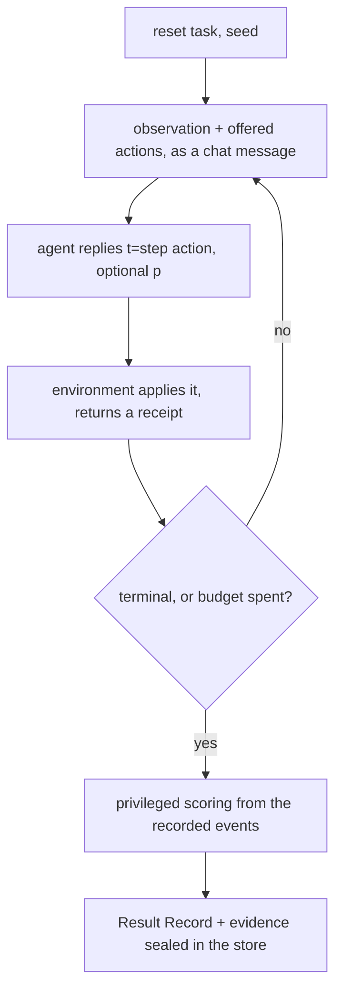

# OmegaEval Wrapper v0

Specification of the harness in this repository. How to use it is in the [guide](GUIDE.md), and OmegaClaw specifics are in [OMEGACLAW.md](OMEGACLAW.md).

## Purpose

One thin harness that every evaluation environment sits behind, so a change to an agent reads as "better here, worse there" across the whole portfolio from one command.

The question it answers about a versioned system: did this change make it more capable, less capable, or both, and in which respects. It is a development instrument for people changing their own systems, not a leaderboard.

Four jobs:

- Run any registered environment against any agent or hive with one command. Nobody hand-wires an agent to each environment.
- Report every run in one Result Record, so a score means the same thing in every environment. An environment declares once what its utility means and supplies the floor and ceiling. Agents never define scoring.
- Compare a candidate against a baseline on matched seeds, in natural units, per seed.
- Keep every run as evidence in an append-only store that can be replayed and cited.

The implementation is the `omegaeval` package. OmegaClaw agents plug in through their own websocket chat channel with no code change, and any other agent over HTTP, a command or a Python class, so a model-only baseline runs beside them. AGI Maze is the first game to wrap. Three small samples ship with the package, one per benchmark shape, to exercise the whole path.

## Scope of v0 and non-goals

v0 is the smallest harness that makes agents comparable across games from a clean checkout. Everything else is a named extension point.

In v0:

- A gateway that serves OmegaClaw's websocket chat channel to many agents at once, one token per agent, and connectors that reach any other agent over HTTP, a subprocess or a Python class.
- The environment adapter contract in three shapes, interactive, question set and memory, with its conformance test and a bundled sample of each shape.
- Benchmarks as plugins: a file in a folder, an installed package, or a config block that points an adapter at a data file. Each has a short id people choose, such as hle or freeciv, plus a display label and name.
- Reference agents: a random policy for the floor and an oracle policy for the ceiling, both playing through the same gateway.
- Log and memory taps that read an agent's cognition from its own logs and memory stores, read-only.
- Integrity guards: tool rules that void an episode, answers held for a judge until a named verdict settles them, data hashed into the run id, evidence grades, recovery of interrupted runs, and harness faults that are counted but never graded.
- Single agents and hives. In a hive one actor moves the game, and the other members advise through relayed messages.
- The Result Record, computed only from recorded evidence.
- Matched comparison per seed, ablation by variant runs, and progress bands between floor and ceiling.
- An append-only store with checksums, exact replay, rebuilds from raw evidence, frozen releases for citation, a query index that keeps large stores fast, and merging of stores from several machines.
- A console, served locally for live runs or exported as one self-contained page.
- A registry on the project site where anyone registers benchmarks and result releases through GitHub. Releases are re-verified from their bundles, and listed rather than ranked.

Not in v0, kept as named extension points (last section): oracle substitution, learned ablation surrogates, curriculum and sentinel lanes, transfer-ring generation, world-model and concept probes, promotion and rollback integration, Atomspace storage, judges that ship with the package.

Non-goals at any version:

- Ranking systems against each other in public. The unit of comparison is one system before and after a change.
- Certifying progress toward general intelligence. The harness reports per-aspect evidence and stops there.
- Prescribing agent internals. Symbolic, neural, LLM-based and hybrid agents meet the same chat contract.
- Scoring steps by default. The episode outcome is the unit. Step scores are optional environment metrics.

## The loop

Every environment runs the same episode protocol, whether the task is a maze, a dataset, a strategy game or a repository. The harness owns the seed, the hidden state and the scoring code. The agent sees only what the gateway sends it.



Rules that keep the loop comparable across environments:

- **Tagged messages.** The agent receives each observation as a chat message tagged `[omegaeval ep=<id> t=<step>]` and replies `ep=<id> t=<step> <action>`, optionally with `p=<0..1>`. The tags keep messages and replies unique and align the agent's log to the step.
- **Fixed predictions.** A prediction, when given, is recorded with its action and never edited. Calibration is scored against what happened.
- **One event log.** The gateway writes every message sent and received to the episode's event log. That log is the source of truth for replay and scoring.
- **Harness budgets.** The harness enforces the budgets, not the agent: the benchmark's step budget, a timeout per step, wall time, and optionally a cap on LLM calls. Running out ends the episode with a typed terminal status.
- **Privileged scoring.** Scoring runs on the privileged side after the episode. The agent never holds an oracle.
- **Read-only evidence.** The agent's own log and memory stores are read throughout, read-only, and kept with the episode.

## Environment adapter contract

A benchmark is a Python class with a small public side and a separated privileged side. It never talks to the agent directly. It returns text, and the gateway delivers it.

It comes in one of three shapes, declared as `kind` in `describe()`:

| Kind | What happens | Examples |
| --- | --- | --- |
| interactive | every observation offers actions and expects one back | AGI Maze, FreeCiv, ARC-AGI-3 |
| qa | one question per episode, answered in free text | Humanity's Last Exam |
| memory | information delivered over messages that expect no reply, then a question | LongMemEval |

Public side:

| Method | Returns | Notes |
| --- | --- | --- |
| `describe()` | id, version, name, kind, tasks, observation and action kinds, utility meaning and direction, brief, renderer, oracle, scoring, tool policy | Declared once. The brief and the tool rules go to the agent at the start of every episode. |
| `reset(task, seed)` | first observation: text, offered actions, public state, whether it expects a reply, whether the reply is free text | The same task and seed must give the same episode. |
| `parse_action(text)` | one canonical action or answer, or none | Maps the agent's free text. |
| `step(action)` | receipt: next observation, valid, effect, done, info | An unparseable reply is a typed failure, never an exception. |
| `delivered()` | receipt for an information-only message | Called once the agent's log shows it read the message. |
| `render()` | a frame of what the agent has been shown: `grid`, `tiles`, `pixels`, `card` or `timeline` | Optional. Without it, the console shows the transcript. Never privileged state. |

Privileged side, harness only:

| Method | Purpose |
| --- | --- |
| `score()` | success, utility, terminal status, steps and metrics. Gold answers and evidence locations live in metrics and are revealed only after the episode. When only a judge can grade, success and utility stay empty with `needs_judge`. |
| `floor()` | utility of the declared trivial policy on this instance |
| `ceiling()` | utility and steps of an oracle on this instance, or none |
| `max_steps()` | the step budget for this instance |
| `solution()` | the oracle's replies, for the oracle reference agent |
| `fingerprint()` | what the episodes depend on besides the code and options, such as the sha256 of the data file. It is hashed into the run id. |

The one sentence in `describe()` that says what utility means, and which direction is better, is the only benchmark-specific semantics the harness carries.

## How agents connect

An agent is anything the harness can reach: OmegaClaw's chat channel, an HTTP endpoint, a command, or a Python class. There is no SDK to implement.

| Agent | How it connects |
| --- | --- |
| OmegaClaw | Its own websocket chat channel: `commchannel=websocket`, with `WS_URL` pointing at the gateway and the agent's token. No code change. |
| Reference policies | `random` and `oracle`, built in. They connect the same way from inside the harness. |
| Any other agent | A connector the harness drives: `http` posts each message as JSON, `command` speaks JSON Lines with a process started per episode, and `python` calls a class's `act()`. Replies are bound to their step, so these agents repeat no tags. The websocket frames work too. |

On the chat channel, every message the agent receives starts with a tag, and every reply starts with the episode and step:

```
[omegaeval ep=3f9a1c1 t=12]          an observation that expects a reply
[omegaeval ep=3f9a1c1 t=12 info]     information to read, no reply expected
ep=3f9a1c1 t=12 move N [p=0.6]       the reply; p only when predictions are on
```

The reply must name the current episode and step. Replies for other steps are recorded and ignored, and anything else is recorded as chatter. The episode tag keeps consecutive replies distinct, because OmegaClaw drops a reply identical to its previous one.

A hive is a named set of agents. Every member receives every observation. Only the actor's replies move the benchmark. The other members get an `Advise:` line, and with relay on, their messages go to the whole hive. Each member's evidence is read separately.

Any agent can report what it did between messages as trace events: LLM calls with tokens, tool calls, memory operations, reasoning steps, context sizes and errors. They fill the same lanes as a parsed OmegaClaw log, and the manifest records them as reported by the agent, a weaker grade of evidence than a Docker log. An agent that keeps its own concepts can report them too, with `{"type": "trace", "kind": "concepts", "step": 12, "concepts": [{"id": "key", "label": "key"}]}`. OmegaClaw sends neither: its cognition is read from its log.

The harness checks that it can reach each agent before it claims an attempt, so a misconfigured agent fails at once with the reason. An agent still answering when its episode ends gets a short grace and is then left behind: it cannot hold up the queue, and a late answer lands in the closed episode, never the next. A command agent runs in its own process group, which is stopped at the end of every episode with everything it started.

## Reading cognition

The environment log says what happened. The trace says what the agent did in between, loop turn by loop turn. For OmegaClaw the harness reads it from the agent's own evidence rather than asking the agent to emit it. Other agents report it as trace events, recorded as their own word.

For OmegaClaw that evidence is the log stream every agent already writes, followed with `docker logs -f -t` or from a log file. Read-only fingerprints of its history file and Chroma store are taken at the start and end of each episode. Each loop turn becomes one record:

```
LoopTurn
  i            the agent's loop iteration number
  t0, t1       first and last timestamps (the docker clock when available)
  human_msg    the message this turn read; its tag names the step
  prompt       size of each prompt section, the input, the previous turn's results
  llm[]        provider, model, finish reason, prompt, cached, completion and reasoning tokens; raw text at DEBUG
  calls[]      each skill call: lane (action, memory, reasoning, tool, error), store and op, arguments, result;
               metta calls add engine (nal, pln, metta, atomspace), premises and conclusions with truth values
  errors[]     loop errors and ERROR lines
```

The step tag in each observation aligns loop turns to game steps exactly, whatever the clocks. Raw log slices are kept with the episode, so a better parser can re-derive every record later.

OMEGACLAW.md lists, field by field, what OmegaClaw provides and what it does not. Prompts, tokens, skill calls, NAL and PLN inference, memory writes and reads, and errors are live. Six things do not exist in OmegaClaw today: reasoning text, a persistent AtomSpace, concept formation, memory amendment, surprise and world-model probes. The console greys them out with the reason.

## Common units: the Result Record

Every run produces the same record, computed only from recorded evidence. A block the evidence cannot support is written as `available: false` with a reason. Nothing is estimated.

```
ResultRecord
  outcome        success, utility, terminal, floor, ceiling, normalized, environment metrics;
                 needs_judge when only a judge can grade; judged with the verdict and its judge;
                 void when a tool rule was broken; not_graded when the harness failed or was stopped
  efficiency     steps, max_steps, invalid_actions, wall_seconds, agent_messages, accepted_actions,
                 messages_delivered
  regret         oracle_steps and extra_steps, for solved episodes, when the benchmark has an oracle
  prediction     n, brier, mean_p, final_p, when the agent stated predictions
  cognition      per agent: iterations, llm_calls, tokens, models, skills, reasoning by engine,
                 atoms in and out, memory ops by store, errors, finish reasons
  tool_policy    forbidden or allowed skills, violations found in the agent's log, whether the episode is void
  cost           USD from tokens and the price table, when one is configured
  world_model    not available on OmegaClaw
  concepts       counts of concepts the agent reported over the gateway, or not available
```

Rules:

- **One scalar.** Normalization is the only scalar the harness computes. Floor and ceiling come from the environment for the same task and seed, so 0.6 means the same distance between trivial and oracle in every environment.
- **No ceiling, no normalization.** When an environment cannot supply a ceiling, the package leaves `normalized` empty. Falling back to the best reference agent on the same seeds is an open question.
- **Stored as measured.** Quantities are stored as measured. The comparison marks each metric better or worse by its declared direction.
- **Absent is not zero.** An absent block is written as unavailable with a reason, and the console greys it out.
- **Judge-held is not wrong.** An answer only a judge can grade is marked `needs_judge` and left out of Solved. A verdict recorded with `omegaeval judge` settles it and names the judge.
- **Void beats everything.** An episode that broke a tool rule is void, whatever its answer.
- **Harness faults are not the agent's.** An episode the harness failed or was stopped during is counted and kept, marked `not_graded` with the reason, and left out of Solved. It is never counted against the agent.
- **Failures are statuses.** Budget and permission failures are terminal statuses, not penalties folded into utility. No utility gain offsets them.

## Run manifest

A run is identified by its inputs. The run id is the benchmark id followed by a hash of them, such as `hle-3f9a1c1b2c3d`, so the same inputs always name the same run and anyone can read which benchmark it belongs to. A re-run adds a new attempt without overwriting an old one.

```
Manifest
  run_id, attempt, status, started_at, ended_at, ep_tag
  identity      harness version, env, env_version, env_options, env_data, task, seed,
                subject, members, actor, label, variant, memory_mode, budgets, protocol
                                                                        (hashed into run_id)
  environment   the adapter's describe()
  benchmark     id, label and name as people see them
  members       per agent: kind, label, recorded config, log and memory sources
  provenance    agent versions announced at connect, models seen in the log,
                memory fingerprints at start and end, log tap status
```

The agent's configuration is recorded as given in omegaeval.toml. It is confirmed where the evidence allows: by the version string OmegaClaw announces, and by the provider and model in every usage line. LLM calls cannot be reproduced bit for bit, so the raw log slice is kept as evidence of what was actually sent and returned.

## Matched comparison

A comparison answers one question: on the same game, task and seeds, where did the candidate do better than the baseline, where worse, and where can we not tell.

1. A set of runs is one subject and variant on one game and task. Two sets are compared on the seeds both ran.
2. Each metric is shown in its own units for both sides, then per seed, marked better, worse or same by the metric's declared direction.
3. A metric either side lacks is shown as not available, with the reason. It is never a zero.

| Metric | Unit | Source |
| --- | --- | --- |
| Solved | episodes out of n | environment |
| Steps | median per episode | environment |
| Extra steps over oracle | median, solved only | environment oracle |
| Invalid actions | median | environment |
| LLM calls | median per episode | agent log |
| Tokens | median prompt plus completion | agent log |
| NAL and PLN calls | median per episode | agent log |
| Memories written | median per episode | agent log |
| Loop errors | median per episode | agent log |
| Cost | USD, median | tokens and price table |
| Prediction Brier score | median | stated predictions |

A normalized outcome, (utility − floor) ÷ (ceiling − floor), is kept in every Result Record for comparisons across games. A per-aspect grid across games is an extension point until two real games are wrapped.

## Ablation and reference agents

Ablation answers which change carried a difference. Reference agents answer whether a game is neither trivial nor impossible. Both are ordinary runs, so they reuse everything above.

**Ablation.** Run the same agent again on the same seeds with one configuration value changed, under a `--variant` label. Compare shows the variants side by side. OmegaClaw lets these be set by configuration: model, provider, reasoning effort, output budget, history and results kept in the prompt, knowledge priors, and fresh or carried memory. NAL and PLN, Chroma memory and concept formation cannot be switched off by configuration today. OMEGACLAW.md says why.

**Reference agents.** Every game gets a floor and a ceiling run through the same gateway: the random policy and the oracle policy. A trained specialist, reinforcement learning or otherwise, registers as one more agent that speaks the chat protocol, with its training budget recorded in its label and config. Progress shows every set of runs between the floor and the ceiling. A game where the specialist sits at the oracle is too easy for the portfolio, and one where it sits at the floor is not yet discriminating.

## Replay and storage

Every episode lives in one directory of plain files in an append-only store. Raw evidence and derived records sit side by side, and nothing derived is edited by hand. [DATA.md](DATA.md) describes the data plan in full, with measured limits.

```
<store>/index.jsonl                        ledger: started, finished, judged, interrupted, replayed, rebuilt, merged; never rewritten
<store>/index.sqlite                       query index derived from the ledger and results; rebuilt when missing
<store>/runs/<run_id>/<attempt>/
    manifest.json                          inputs and provenance
    env.jsonl                              every message sent and received (evidence)
    judgments.jsonl                        verdicts, when a judge graded the answer (evidence)
    agents/<agent>/omega.log.gz            raw log slice, compressed when the episode ends (evidence)
    agents/<agent>/trace.jsonl             parsed loop turns (derived)
    result.json                            the Result Record (derived)
    checksums.json                         sha256 of every file
<store>/releases/<name>/release.json       frozen attempts with checksums, for citation
```

| Operation | What it does |
| --- | --- |
| Trace replay | The console steps through any episode from its files. Always available. |
| Exact replay | `omegaeval replay` re-runs the environment from the recorded seed with the recorded actions, and checks every receipt and the final score. It proves the environment is deterministic and the log complete. |
| Rebuild | `omegaeval rebuild` re-derives traces and results from the raw logs with the current parser. Evidence is untouched. |
| Judge | `omegaeval judge` appends a verdict from a person or a judge command to an answer the benchmark held, and recomputes the result. |
| Release | `omegaeval release` freezes a named set of finished attempts with checksums. A release is never overwritten, and a released attempt is never judged or rebuilt again. |
| Verify | `omegaeval verify` checks every file against its checksums, and a release against what it froze. |
| Export | `omegaeval export` writes attempts to one JSON file, or into a self-contained console page. It can drop prompt text, which may carry an agent's history from other chats. |
| Merge | `omegaeval merge` copies another store's finished attempts in, renumbering an attempt whose number is taken and recording where it came from. |
| Reindex | `omegaeval reindex` rebuilds the query index from the ledger and the result files. |

The console and the command line query the index, never every file, so the cost of a query depends on its page size rather than on the size of the store. At 20,000 attempts a console refresh transfers about 4 KB.

Live replay of the agent itself, from a snapshot, is an extension point. So is mirroring the store into Atomspace.

## Integrity guards

| Guard | What it prevents |
| --- | --- |
| Tagged messages and replies | OmegaClaw ignoring a repeated observation or dropping a repeated reply, and loop turns misaligned with steps |
| Read confirmation | the next information message arriving before the agent read the last one |
| Message splitting | messages over the 64 KiB frame limit of OmegaClaw's websocket client breaking the connection |
| Tool rules | an exam answered with outside help: forbidden skills or an allowed list go in the brief, every skill call is checked, and a violation voids the episode |
| Judge-held answers | a possibly correct answer counted as wrong: it is held out of Solved until a verdict settles it |
| Named verdicts | an anonymous or silently changed grade: each verdict is appended as evidence with who gave it, and the record says when verdicts disagree |
| Data identity | a new version of a dataset mixed with the old: the benchmark's options and its data file's sha256 are hashed into the run id |
| Evidence grade | trusting a log the agent could have written: docker logs are held by the daemon, while a log file is writable by the agent's process, and a trace reported over a connector is the agent's own word |
| Interrupted runs | an attempt cut short by a crash or a stop: Ctrl-C and SIGTERM record it as interrupted at once, and one left running by a harness that died is marked on the next start. Either way it is counted, never graded |
| Harness faults | a failure of the harness counted as the agent's: the attempt is kept and counted, marked `not_graded`, and left out of Solved |
| Hung agents | an agent that never answers holding up the queue: the episode ends at the step timeout, and a late answer lands in the closed episode, never the next |
| Agent processes | a command agent's helpers outliving the episode: its process group is stopped at the end of every episode and when the harness exits |
| Torn writes | a crash in the middle of a ledger write losing the next record: the torn line is ended first, and each record is on disk before the harness moves on |
| LLM call budget | runaway spend: the episode ends when the agent's log or reported trace shows more calls than allowed |
| One store per machine | a ledger split by two machines writing through a synced folder: doctor warns, and stores from several machines combine with merge |
| Exact replay, checksums, frozen releases | a record that cannot be checked, or that changes after publication: `omegaeval verify` checks every file, and a released attempt is never changed |

## Concept and symbol probe

The probe is how the harness would score what an agent carves out of its observations: which recurring things it treats as one thing, when each formed, and whether it holds. It stays in the spec because symbol formation is the capability most worth seeing. It is not measurable on OmegaClaw today.

OmegaClaw has no persistent concept store. Each metta call starts with a fresh AtomSpace, so there is nothing between calls to read. The harness does show the atoms in and out of every NAL and PLN call, with truth values, turn by turn.

For an agent that does keep concepts, the probe is an export at checkpoints:

```
ConceptSet
  step
  concepts[]   id (stable across steps and episodes), grounding[] in the environment's scheme,
               label (stored, not scored), confidence, derived_from[] for merges and splits
```

Agents that keep concepts can already report them over the gateway with a trace frame, and the console draws them in the Concepts lane. Scoring them against the environment's hidden entities, for precision, recall, re-identification and stability, remains an extension point. So does reuse, when the same concept ids carry into a second rendering of the same task. On OmegaClaw a concept store has to exist first. The plugin API's heartbeat listener is where an export would hook in.

## Console layout

The console is one HTML page. Served by `omegaeval serve`, it reads the store live and can start episodes. Exported, it carries its runs inside and opens anywhere. A benchmark selector at the top, showing each benchmark's label and name, scopes every view, and a find box narrows the runs by agent, variant, seed or run id. It has five views:

- **Play.** One episode. It shows the world as the agent has seen it, drawn by the benchmark's renderer or as a transcript, beside a strip with one column per loop turn and one lane per phase: observation, context in, LLM call, NAL and PLN, belief, action, errors and refusals, memory, atoms, surprise, concepts. Clicking a column shows the actual message, prompt sections, tokens, skill calls with their results, and the environment's receipt. Each hive member gets its own strip, and another run of the same seed can be stacked underneath.
- **Compare.** Two sets of runs on the same benchmark, metric by metric in natural units and per seed, then ablation variants side by side.
- **Progress.** For each benchmark, the solve rate of every set of runs between the random floor and the oracle, plus a ledger by the version each agent announced.
- **Runs.** Every benchmark the harness found and where it came from, and every attempt in the store. Served locally, it also starts episodes for any configured agent or hive and shows which agents are connected.
- **Sources.** Every field in the console, where it comes from, and whether the selected run carries it.

A field whose source a run lacks is greyed out and names the reason. Queuing a benchmark in Runs is what instructs the agent. The harness sends that benchmark's brief to the agent's chat channel, and the episode starts.

## Command line

```
omegaeval init                                  write omegaeval.toml with a token per agent
omegaeval doctor                                check the config, agents, log sources, memory paths and benchmarks
omegaeval connect oma-1                         print the command that points an agent at the harness
omegaeval serve                                 gateway, episode queue and console
omegaeval benchmarks                            installed benchmarks and where each comes from
omegaeval run oma-1 keydoor --seeds 1-5 [--task classic] [--variant reasoningMode=low] [--memory fresh]
omegaeval baseline random|oracle keydoor --seeds 1-5
omegaeval status                                agents, connections, queue
omegaeval new-benchmark NAME --kind interactive|qa|memory
omegaeval conform keydoor                       the nine admission checks
omegaeval judge [attempts ...]                  answers held for a judge; --verdict or --command records one
omegaeval replay [attempts ...]                 exact replay against the recorded receipts
omegaeval rebuild [attempts ...]                re-derive traces and results from raw logs
omegaeval import-log omega.log                  view any OmegaClaw log on its own
omegaeval export [attempts ...] --out runs.json | --html report.html [--redact-prompts]
omegaeval release NAME [attempts ...]
omegaeval verify [release ...]                  check every file against its checksums
omegaeval merge STORE [STORE ...]               copy other stores' finished attempts into this one
omegaeval reindex                               rebuild the query index
```

Attempts are named by run id, run id prefix, benchmark id such as `hle`, or `key=value` filters such as `subject=oma-1`. `run` queues episodes on a running harness and returns. Each subject plays one episode at a time, and different subjects play in parallel. Everything the console shows is computed from the store. [REFERENCE.md](REFERENCE.md) lists every option.

## Benchmarks as plugins

The first games to wrap, in order of readiness, are AGI Maze, Virtual Scientist synthetic datasets, FreeCiv and ARC-style games. Later waves follow the environment portfolio in the OmegaHive ProtoAGI Test Suite document. Community benchmarks wrap the same way.

Benchmarks are found in four places. A later one overrides an earlier one with the same id.

1. **Built in:** keydoor, qa-sample and memory-sample. They exercise the harness and are not benchmarks to report.
2. **An installed package:** one that declares an `omegaeval.environments` entry point.
3. **A file:** any `.py` file in `./benchmarks`, or in a folder listed in `[harness] benchmark_dirs`.
4. **A config block:** an `[environments.<id>]` block with an adapter and options. One adapter can serve several benchmarks with different data files. Humanity's Last Exam is `QADataset` with a question file, and LongMemEval is `ChatMemory` with its dataset file.

Benchmarks graded by a judge model, as Humanity's Last Exam and LongMemEval are, set `judge_all` and take their verdicts through `omegaeval judge --command`.

`omegaeval new-benchmark <name> --kind interactive|qa|memory` writes a template that already passes conformance. `omegaeval doctor` checks every installed benchmark before anything runs.

A benchmark is admitted when `omegaeval conform` passes nine checks:

1. `describe()` is complete, including what utility means and which direction is better.
2. Reset, step and deliveries are deterministic for a seed.
3. Different seeds give different episodes.
4. An unparseable reply is a typed failure, not an exception.
5. Offered actions and free-text answers survive `parse_action`.
6. Floor and ceiling references are declared. A benchmark without an oracle says so.
7. `score()` reports success, utility, terminal status and steps, and a judge-held answer leaves success empty.
8. `render()` returns a known frame type or nothing.
9. The agent's view does not contain the privileged solution.

Passing conformance is the whole admission process for v0. Difficulty calibration, specialist baselines and validity controls follow the companion qualification document, and they do not gate wrapping.

## Definition of done for v0

v0 is done when all of the following hold from a clean checkout. The package meets the first six today, tested against the three bundled samples and the reference agents.

1. One command queues episodes for an agent or hive, and the harness plays them through the agent's own chat channel.
2. Every episode is stored with its evidence and checksums, and replays exactly.
3. The Result Record reports only what evidence supports, and marks the rest unavailable with the reason.
4. Compare, Progress and ablation variants work from the store alone.
5. A release freezes a set of attempts for citation and can never be overwritten.
6. An exported console opens anywhere with its runs inside.
7. An OmegaClaw agent plays keydoor over the gateway, and its log turns align to every step. The parser is tested on real OmegaClaw log lines, but this still needs a run against a live agent.
8. AGI Maze passes conformance and appears in Compare next to keydoor with no change to the harness.
9. Humanity's Last Exam and LongMemEval run from their dataset files through the built-in adapters, with their judges plugged in.

## Extension points deferred past v0

Each item below has a named slot in v0 and no implementation. The slot is the contract. The implementation arrives with the environment or experiment that needs it.

| Extension | Where it plugs in | What v0 leaves for it |
| --- | --- | --- |
| Concept and world-model probes | `describe()` probe schemas, a plugin on the agent | an export of the agent's concepts or map, scored against hidden state |
| Richer prediction envelope | the reply format | expected cost, information gain, next observation |
| Oracle substitution | privileged side | the oracle's planner with the agent's model, and the reverse |
| Learned ablation surrogates | variant runs | impact estimates at scale, recalibrated against exact variants |
| Curriculum, promotion and sentinel lanes | task list, seeds | private generators instantiated after the agent is frozen |
| Transfer ring | renderers of one latent task | the same task in several games, with reuse measured across them |
| Learning across episodes | memory fingerprints, carried memory | retention and relearning aspects |
| Live replay of the agent | agent snapshots | branching experiments from a saved state |
| Promotion, shadow and rollback | the comparison output | a policy that reads Compare and acts on it |
| Atomspace storage | the store | a one-way mirror of manifests, results and traces |
| Built-in judges | `omegaeval judge --command` | a judge that ships with the package; v0 takes verdicts from people and external commands, and every record names its judge |
